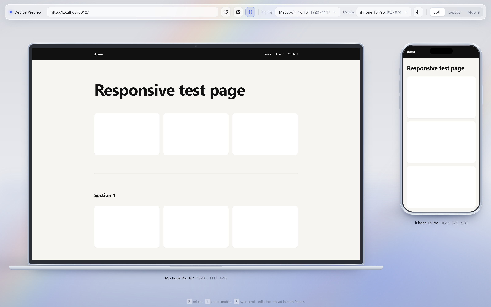

# skill

Design and frontend skills by Bayu Krisnayana.

## device-preview



Opens your local site in one browser tab with a **laptop frame and a mobile frame side by side**,
so you can check responsive layout without resizing any window. Scrolling and clicking links in one
frame is mirrored in the other, and hot reload updates both.

- Laptop sizes: MacBook Pro 16" / 14", MacBook Air 15" / 13", laptop 1440 / 1366 / 1280, desktop 1080p / 1440p
- Mobile sizes: iPhone 16 Pro / Pro Max / 15, iPhone 13 mini, iPhone SE, Pixel 9, Galaxy S24, small Android, iPad mini, iPad Air
- Rotate mobile to landscape, show both devices or just one (Both / Laptop / Mobile)
- Both devices share one scale, so their real size relation stays true
- Synced scroll and navigation (toggle with the ⇅ button)
- Shortcuts: `R` reload both, `L` rotate mobile, `S` toggle sync
- Tested with Vite and Next.js, including hot reload

## Install

Pick one.

### npx

```bash
npx skills add komangbayu04/skill@device-preview
```

Then run `/device-preview` in Claude Code. The same command also installs the skill for
other agents such as Cursor and Codex, but it is built and tested for Claude Code.

### Claude Code plugin

Inside Claude Code:

```
/plugin marketplace add komangbayu04/skill
/plugin install bayu@bayu-skills
```

Then run `/bayu:device-preview`. To get updates later, run `/plugin marketplace update bayu-skills`.

### Manual

```bash
git clone https://github.com/komangbayu04/skill
cp -r skill/skills/device-preview ~/.claude/skills/
```

Then run `/device-preview`.

## Usage

```
/device-preview                          # finds or starts your dev server
/device-preview 5173                     # a specific port
/device-preview http://localhost:3000/pricing
```

Or ask your agent to "check the responsive layout".

## How it works

The skill starts a small local server (port 4747) that shows the preview and proxies your dev
server through the same origin. That is what allows the two frames to sync scroll and navigation.
Stop it with Ctrl+C or by ending the background task.

Requires Node 18 or newer. No dependencies.

## License

MIT
